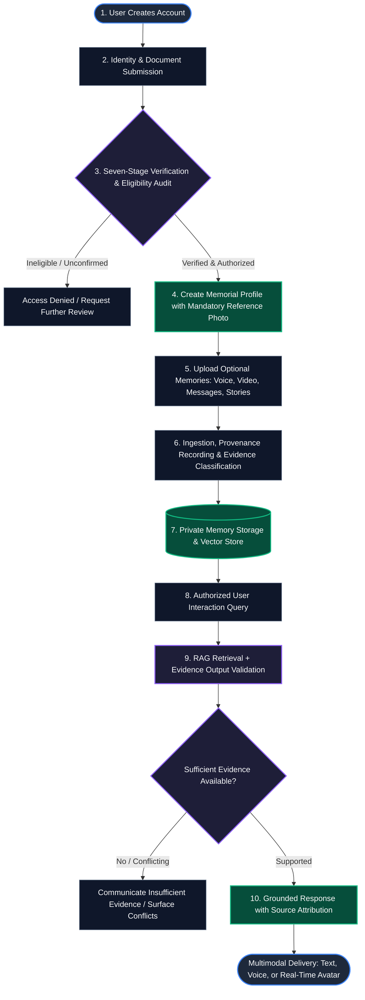

# MEMORA — Executive Project Presentation & Research Architecture Briefing

**Document Type:** Client-Facing Project Introduction, Research Alignment & Technical Architecture Briefing  
**Project Name:** MEMORA  
**Category:** AI-Powered Digital Memory & Legacy Interaction Platform  
**Target Format:** Mobile-First & Desktop-Optimized Responsive Web Application  
**Development Environment:** Google Antigravity  
**Author / Roles:** Senior Research Architect, Technical Consultant, UI/UX Presentation Designer  
**Status:** Client Review & Architectural Baseline (Pre-Development Alignment Milestone)

---

## Executive Summary

**MEMORA** is a proposed privacy-conscious, ethical, AI-assisted digital memory and legacy interaction platform. It is conceptualized to allow verified, authorized family members to preserve, organize, and interact with an AI representation of a deceased loved one using authenticated personal materials, archival media, and verified life records.

> [!IMPORTANT]
> **Foundational Ethical Clarification & Reality Boundary:**  
> Memora does **not** bring a deceased person back to life, recreate human consciousness, simulate sentience, or establish communication with the afterlife. It provides an **AI-generated representation based on available and authorized information**. The platform is designed to maintain transparent, continuous AI identity disclosure at every layer of user interaction.

---

## 1. The Problem We Aim to Address & Proposed Approach

### The Problem
1. **Fragmented Legacy Materials:** Important family memories are scattered across photographs, home videos, voice recordings, messages, personal documents, and letters without central organization.
2. **Loss of Preservation and Context Over Time:** Over generational transitions, materials degrade and critical personal context is lost as memories fade.
3. **Absence of Evidence-Grounded Interaction:** Existing digital memorial solutions are typically static repositories (e.g., flat obituaries, basic photo albums) and do not provide an integrated, evidence-grounded conversational experience.
4. **Privacy, Identity, and Vulnerability Concerns:** Families need a privacy-conscious, tightly controlled environment to preserve intimate memories without exposing digital footprints to unauthorized access or ungrounded generative distortion.

### How Memora Proposes to Address These Challenges
* **Multi-Stage Verification:** A structured verification architecture to validate identity, death, family relationship, and adult eligibility before memorial access is granted.
* **Retrieval-Augmented Generation (RAG):** AI responses are designed to retrieve relevant evidence from authorized personal materials, accompanied by output validation checks to evaluate grounding.
* **Three-Tier Evidence Attribution:** Transparent categorization of all information so users understand the evidentiary source behind every interaction.
* **Relationship-Aware Access Control:** Access rules that restrict intimate or romantic interaction registers exclusively to verified adult legal spouses.

*Note: Memora does not make unsupported psychological, medical, or scientific claims.*

---

## 2. Platform User Journey & System Lifecycle



---

## 3. Seven-Stage Verification Framework

The platform architecture defines seven distinct verification stages before authorized interaction is permitted:

1. **Requester Identity Verification:** Verification of the identity of the person requesting account and memorial access.
2. **Deceased Identity Verification:** Verification of the identity and historical records of the deceased individual.
3. **Death Verification:** Submission and review of official death documentation.
4. **Relationship Verification:** Examination of legal relationship documentation (e.g., marriage certificates, birth records).
5. **Adult Eligibility Verification:** Confirmation that requesters and participants meet applicable adult age requirements.
6. **Authorization Decision:** A formal authorization assessment determining whether access should be granted and at what scope.
7. **Resource-Level Access Control:** Continuous backend enforcement of authorization decisions for every individual resource and interaction query.

> [!NOTE]
> **Verification Status Disclosure:**  
> External verification sources, third-party ID providers, and government registry integrations are proposed architectural targets and are **not yet confirmed or integrated**. The upcoming demonstration will simulate these verification stages for workflow illustration.

---

## 4. Main Platform Features

### A. Authentication and Account Management
* Secure account registration and login architecture.
* Password-based authentication with session management.
* Support for OTP and multi-factor verification where supported by infrastructure.
* Planned demo capabilities include user registration, login flows, and session inspection.

### B. Identity and Relationship Verification
* Multi-stage verification pipeline covering all seven stages.
* Structured review of requester identity, deceased records, death records, and family relationship.
* Resource-level access restrictions dynamically enforced by the backend.

### C. Memorial Profile Creation
* **Mandatory Baseline:** Submission of a mandatory reference photograph.
* **Optional Materials:** Voice recordings, videos, personal correspondence/messages, and family memories are optional additions.
* Profile configuration, biographical details, and memorial administration.

### D. Private Memory Storage
* Architectural isolation separating legal verification documents from conversational memory sources.
* Proposed private object storage with access control mechanisms and planned encryption.

### E. AI-Powered Memory Conversation
* Evidence-grounded conversational architecture using Retrieval-Augmented Generation (RAG).
* Semantic retrieval of relevant memories with evidence and source attribution.
* Output validation to check whether generated responses are supported by retrieved records.
* Explicit communication when information is unavailable, and surfacing of conflicting evidence.

### F. Voice Interaction
* Speech-to-text (STT) for conversational input.
* AI response generation paired with text-to-speech (TTS) synthesis.
* Personalized voice representation subject to explicit authorization and available audio samples.

### G. AI Avatar and Video Experience
* Visual representation based on the mandatory reference photograph.
* Potential facial animation and lip synchronization interface.
* Real-time communication interface using compatible web streaming technologies (e.g., WebRTC).

---

## 5. Evidence Classification & AI Transparency Model

Memora enforces a strict **Three-Tier Evidence Classification** model aligned with the research manuscript:

```
┌────────────────────────────────────────────────────────────────────────┐
│                   MEMORA EVIDENCE CLASSIFICATION                       │
├────────────────────────────────────────────────────────────────────────┤
│  LEVEL A — DIRECT EVIDENCE (Primary Authority)                         │
│  - Original material created or recorded directly by the deceased.     │
│  - Examples: Audio recordings, written journals, direct letters.       │
├────────────────────────────────────────────────────────────────────────┤
│  LEVEL B — FAMILY TESTIMONY (Attributed Secondary Source)              │
│  - Memories, descriptions, and anecdotes provided by authorized family.│
│  - Explicitly attributed to its contributor (e.g., "Shared by [Name]"). │
├────────────────────────────────────────────────────────────────────────┤
│  LEVEL C — AI INFERENCE (AI-Generated Interpretation)                   │
│  - Contextual synthesis and AI-derived interpretations.                │
│  - Explicitly identified as AI inference to all users.                 │
│  - NEVER presented as an authentic memory or direct statement.         │
└────────────────────────────────────────────────────────────────────────┘
```

### AI Grounding, Limitations, and Transparency
* **RAG Retrieval & Output Validation:** The system retrieves relevant records and applies output validation checks to evaluate whether responses are supported by the evidence.
* **No Claim of Zero Hallucinations:** RAG significantly reduces unsupported generation, but **cannot guarantee that hallucinations are completely eliminated**.
* **Insufficient Evidence Handling:** When reliable evidence is unavailable, the AI must communicate that limitation clearly rather than inventing a response.
* **Conflicting Evidence Surfacing:** If ingested materials present conflicting accounts or contradictory recollections, the system surfaces the discrepancy rather than silently resolving it.

---

## 6. Privacy, Security, and Responsible AI Safeguards

The platform defines key safeguards as **design and implementation objectives** (not claims of completed production security certification or absolute security):

* **Identity and Relationship Verification:** Multi-stage checks prior to memorial access.
* **Backend-Enforced Authorization:** Resource-level permission enforcement on every request.
* **Private Data Storage:** Segregation of verification records from conversational memory banks.
* **Encryption and Secure Access:** Proposed data encryption at rest and in transit.
* **Audit Logging:** System logging designed to record administrative and access events.
* **Protection Against Unauthorized Access:** Continuous access control evaluation.

### Psychological Safety Objectives
* Psychological safety is a **design objective and ongoing evaluation area**, not a validated medical or psychological outcome.
* The platform aims to explore emotional safety boundaries, but automated distress detection and professional referral are **proposed evaluation concepts**, not implemented features.
* The platform does not make claims of clinical efficacy or grief therapy outcomes.

### Relationship-Aware Access Control
* **Exclusive Spousal Privilege:** Romantic or intimate interaction modes are **restricted exclusively to verified adult legal spouses**, subject to passing all identity, death, relationship, and adult eligibility checks.
* **Prohibited Relationships:** Romantic or intimate modes are **not available** to dating partners, boyfriends, girlfriends, lovers, friends, siblings, or other relationships.
* **Resource-Level Enforcement:** Spousal authorization decisions must be verified at the resource level for every applicable request.
* **Universal Protections:** General AI safety, privacy rules, and transparency boundaries remain active for all users, regardless of relationship tier.

---

## 7. Proposed Technology Architecture

The following technologies represent the proposed architectural candidates based on research requirements. **None of these technologies are currently deployed or integrated**, as application development has not begun.

| Layer | Proposed Candidate Technology | Architectural Role |
|---|---|---|
| **Development Environment** | Google Antigravity | Project development, prototyping, and validation environment |
| **Frontend Framework** | Next.js, React, TypeScript | Proposed candidate for responsive, mobile-first web user interface |
| **UI Styling** | Tailwind CSS | Proposed design system for typography, dark mode, and responsive layout |
| **Backend Framework** | Python, FastAPI | Proposed candidate for asynchronous API routing and RAG orchestration |
| **Relational Database** | PostgreSQL | Proposed candidate for user records, authorization logs, and metadata |
| **Vector Search** | pgvector / Candidate Vector Store | Proposed candidate for semantic memory embedding indexation |
| **Caching & Queues** | Redis (if required) | Candidate for temporary caching and ingestion queues |
| **Private File Storage** | Private Object Storage Service | Proposed candidate for isolated document and media storage |
| **AI Memory Engine** | RAG Architecture + Candidate LLM API | Candidate framework for contextual retrieval and output validation |
| **Speech-to-Text (STT)** | Candidate STT Service | Speech recognition candidate for spoken user queries |
| **Voice Synthesis (TTS)** | Candidate TTS Service | Speech synthesis candidate for audio representation |
| **Real-Time Video / Avatar**| WebRTC-Compatible Service | Candidate streaming framework for interactive avatar display |
| **Application Monitoring** | Candidate Monitoring Tools | Proposed candidate tools for performance and error tracking |
| **Deployment** | Suitable Cloud Hosting | Proposed candidate cloud hosting environment |

---

## 8. Development Stages Roadmap

The proposed development plan is organized into 11 distinct stages:

* **Stage 1 — Project Foundation:** Requirements review, architecture baseline, responsive UI/UX design system.
* **Stage 2 — Authentication:** Account registration, login workflows, session management.
* **Stage 3 — Verification System:** Requester identity, deceased identity, death verification, relationship verification, adult eligibility, authorization decisions, resource-level controls.
* **Stage 4 — Memorial Profile:** Profile creation, mandatory reference photo ingestion, biographical configuration.
* **Stage 5 — Memory Management:** File upload pipeline, private storage separation, memory organization, evidence classification (Levels A, B, C).
* **Stage 6 — AI Memory Engine:** RAG retrieval pipeline, evidence output validation, conflicting evidence handling, source attribution.
* **Stage 7 — AI Conversation:** Text interaction interface, conversation history, insufficient-evidence handling.
* **Stage 8 — Voice Experience:** Speech input (STT), voice synthesis (TTS), voice permission boundaries.
* **Stage 9 — AI Avatar Experience:** Visual representation from reference photo, facial animation, real-time video/avatar communication.
* **Stage 10 — Security and Testing:** Backend access control validation, responsive UI testing across viewports, security checks.
* **Stage 11 — Demo Preparation:** End-to-end workflow integration, bug remediation, presentation readiness, final demonstration.

---

## 9. Demo Scope, Status, and Transparency

* **Pre-Development Status:** Application source code development has not yet started. The upcoming demo is being designed to showcase the research architecture.
* **Planned Demo Capabilities:** Polished responsive UI/UX, simulated user journeys (authentication, profile creation, memory upload), evidence-grounded AI conversation simulation with Level A/B/C source badges, and relationship-aware access demonstrations.
* **Simulated & External Dependencies:** External government death registries, third-party identity verification providers, and high-fidelity real-time lip-sync pipelines will be simulated or dependent on candidate external APIs.
* **Academic & Commercial Integrity:** No fabricated benchmarks, user-study results, psychological efficacy claims, or security certifications are claimed.

---

## 10. Research Limitations (from Manuscript)

In alignment with the original Memora research manuscript, the following limitations are explicitly acknowledged:

1. **Jurisdictional Variability:** Legal verification requirements, death certificate access, and estate privacy laws vary significantly across jurisdictions.
2. **Imperfect Grounding:** RAG significantly improves factual alignment but cannot guarantee zero hallucinations or complete factual infallibility.
3. **Voice Similarity vs. Identity:** Acoustic voice similarity generated by TTS does not constitute proof of identity or personhood.
4. **Visual Realism vs. Consciousness:** Avatar photorealism or animation fidelity does not establish consciousness or subjective awareness.
5. **Unvalidated Psychological Outcomes:** The long-term psychological impacts of interacting with AI representations of deceased loved ones have not been clinically established.
6. **Pending Legal Compliance:** Comprehensive formal legal and regulatory compliance assessments (e.g., post-mortem privacy, digital estate law) have not yet been completed.
7. **No Absolute Security:** No digital platform can guarantee absolute security or complete immunity from potential vulnerabilities.

---

## 11. Interactive Presentation Deck Reference

The interactive client presentation companion file [`index.html`](file:///c:/Users/Acer/OneDrive/Desktop/NNP@4%20maji/AIC/index.html) has been updated to reflect all 10 research corrections across its 14 slides, maintaining a responsive layout, keyboard navigation, and client-facing clarity.
